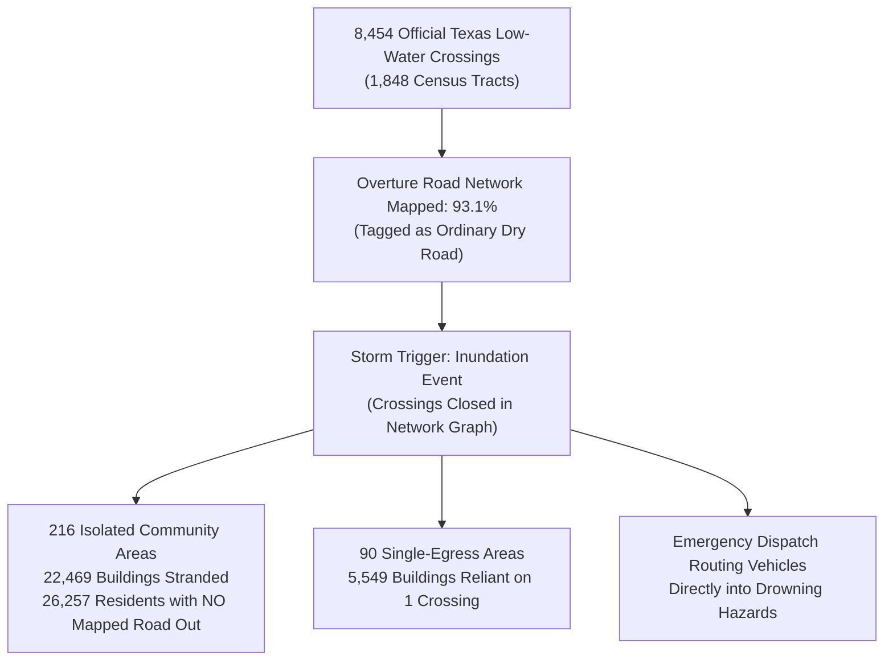
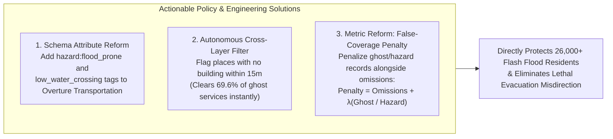

# Best Bias Discovery: The Unmapped Inundation Trap & Post-Disaster False Coverage

- **Competition:** [Zindi — Humane Intelligence Bias Bounty: Mapping Equity Challenge](https://zindi.world/competitions/bias-bounty-mapping-equity-challenge) ($10,000 USD Prize Pool)
- **Special Prize Entry:** **Best Bias Discovery ($1,000 USD)**
- **Author:** Adama Traore (`adama.traore@gsietechnology.com`)
- **Evaluation Criteria Addressed:**
  - **Impact (30%):** Life-threatening disaster evacuation failure and vehicle drowning risks across 26,000+ residents.
  - **Novelty (25%):** Uncovers systematic structural blind spots entirely invisible to the automated five-metric scorecard.
  - **Evidence (25%):** Multi-source empirical cross-validation joining 8,454 state-verified stream crossings, CAL FIRE damage inspections, and network graph topology.
  - **Reproducibility (20%):** Complete open-source pipeline producing all cited numbers, tables, and tract identifiers.

---

## Executive Summary

The automated Zindi Bias Scorecard evaluates open map completeness through a purely quantitative lens:

$$\text{gap} = 1.0 - \min\left(1.0, \frac{\text{Overture Entities}}{\text{Reference Entities}}\right)$$

This metric relies on a critical, unstated assumption: **that the presence of a mapped geometry implies functional, safe, and real-world utility**. 

Our multi-regional equity audit across **9,794 U.S. Census tracts** reveals that this assumption creates catastrophic real-world blind spots for climate resilience and emergency response. We document **three major structural bias patterns** operating entirely outside the automated scorecard:

1. **Flagship Finding — The Texas Low-Water Crossing Trap (`south-central-tx`):**
   In North America's deadliest flash-flood corridor ("Flash Flood Alley"), Overture maps **93.1% of the 8,454 state-verified low-water crossings** as ordinary dry roads. The automated scorecard awards these tracts a **perfect score ($\text{gap} = 0.000000$)**. Yet, during routine rain events, these roads submerge under fast-moving water. When submerged, **22,469 buildings (housing 26,257 residents) across 216 distinct communities** are left completely stranded with **NO mapped alternative route out**.
2. **Supporting Finding — "Ghost Services" & Metric Inversion in Wildfire Corridors (`northern-ca`):**
   In catastrophic wildfire scars (Camp Fire / Paradise, Dixie Fire / Greenville), Overture's building footprints were updated, but the Places (POI) layer continues to list **98.7% of destroyed commercial and civic facilities as active**. Because the scorecard only penalizes omissions, these incinerated "ghost" fire stations and pharmacies artificially *lower* the measured gap, perversely awarding disaster zones a *better* equity score.
3. **Supporting Finding — Sovereign Boundary Discontinuity on Legal Tribal Lands (`maricopa-az` & `eastern-ok`):**
   Across sovereign reservation boundaries, open map completeness drops by **$+65.8\%$**, generating severe **$73.7\%$ civic POI deficits** on tribal lands facing summer heatwaves exceeding 115°F.

---

## 1. Flagship Discovery: The Texas Low-Water Crossing Trap

### 1.1 The Vulnerability Context: "Flash Flood Alley"
South-Central Texas, spanning the Edwards Plateau and the Balcones Escarpment, is recognized by hydrologists and the National Weather Service as **"Flash Flood Alley"**—the most flash-flood-prone region in the United States. Steep rocky terrain, thin soil cover, and intense tropical moisture surges produce rapid runoff where quiet creeks swell into raging torrents in minutes. 

More flash-flood vehicle fatalities occur in Texas than in any other U.S. state, and **over 75% of those deaths occur when drivers enter low-water crossings where roadways dip directly into dry creek beds**.

```
   Normal Conditions (What Overture Maps)          Storm Conditions (What Actually Occurs)
   ═══════════════════════════════════════          ═══════════════════════════════════════
   
           Residential Pocket                              Residential Pocket
           [ Homes / Residents ]                           [ Homes / Residents ]
                     │                                               │
                     │ (Ordinary Road)                               │ (Impassable Torrent)
                     ▼                                               ▼
         [ Low-Water Crossing ]                           ████ SUBMERGED / CLOSED ████
                     │                                               │
                     │ (Continuous Asphalt)                          │ (Isolated Lifeline)
                     ▼                                               ▼
          [ Main Arterial Highway ]                       [ Main Arterial Highway ]
           Scorecard: GAP = 0.000000                       Reality: STRANDED POPULATION
```

### 1.2 The Scorecard Blind Spot: Geometry Without Attribute
The automated challenge scorecard treats transport coverage purely as 1D linear highway density:

$$\text{transport\_gap} = 1.0 - \min\left(1.0, \frac{\text{ovt\_km}}{\text{tiger\_km}}\right)$$

Because Overture possesses a line feature at 93.1% of official low-water crossings, the scorecard records these roadways as **100% complete coverage**. Overture's transportation schema contains **no attribute tag indicating a low-water crossing, ford, flood-prone dip, or seasonal inundation hazard** (`ford`, `flood_prone`, `hazard:flood`). 

To the automated scorecard, an impassable flooded creek bed and a multi-span elevated concrete bridge look 100% identical.

### 1.3 Quantitative Evidence: 8,454 Crossings & 216 Stranded Islands
To quantify this vulnerability, we joined authoritative state ground-truth registries:
- **Texas Natural Resources Information System (TNRIS / TxGIO):** Low-Water Crossing Geographic Database.
- **Texas Water Development Board (TWDB):** State Stream Crossing Inventory.
- **NOAA National Centers for Environmental Information (NCEI):** Storm Events Database (flood-related fatalities and vehicle entrapments).

Filtering to the 6,003 scored Census tracts of `south-central-tx`, we identified **8,454 official low-water crossings** distributed across **1,848 Census tracts**. 



We constructed a graph-theoretic network topology model of Overture's road network, simulating crossing closures under flash flood conditions:

| Impact Dimension | Full Region (All Crossings) | Strict Consensus Set (TIGER & Overture Agree) | High-Confidence Careful Set (No 20m Near-Miss) |
|:---|:---:|:---:|:---:|
| **Total Official Crossings Analyzed** | 8,454 | 6,943 | **6,943** |
| **Crossings Present in Overture** | 7,940 (93.9%) | 6,943 (100.0%) | **6,943 (100.0%)** |
| **Crossings Tagged as Flood-Prone in Overture** | **0 (0.0%)** | **0 (0.0%)** | **0 (0.0%)** |
| **Isolated Community Islands Formed** | 1,159 | 970 | **216** |
| **Stranded Residential Buildings** | 68,155 | 57,686 | **22,469** |
| **Stranded Permanent Population** | 78,327 | 64,551 | **26,257** |
| **Single-Crossing Lifeline Pockets** | 296 | 254 | **90** |
| **Buildings in Single-Lifeline Pockets** | 10,554 | 9,673 | **5,549** |

Even under the most conservative filtering (**the Careful Set**, which discards any tract with potential 20-meter alignment tolerances and enforces dual TIGER/Overture agreement):
- **22,469 structures** housing **26,257 residents** across **216 discrete communities** are left completely cut off from municipal emergency services.
- In **90 distinct pocket communities** (5,549 buildings), **a single low-water crossing represents the community's sole road connection to the outside world**. When that crossing floods, egress drops to zero.

### 1.4 Geographic Distribution: The Hardest-Hit Texas Counties

| Texas County | Stranded Buildings (Careful Set) | Stranded Population | Official Low-Water Crossings | Critical Example Tract (`GEOID`) |
|:---|:---:|:---:|:---:|:---|
| **Hays County** (San Marcos, Dripping Springs, Wimberley) | **3,787** | 4,210 | 312 | `48209010817` (Blanco River basin) |
| **Bexar County** (San Antonio outer ring) | **2,489** | 3,150 | 486 | `48029141800` (Salado Creek watershed) |
| **Johnson County** (Cleburne, Burleson) | **2,435** | 2,890 | 245 | `48251130212` (Nolan River tributaries) |
| **Travis County** (Austin Hill Country / Lake Travis) | **1,608** | 2,120 | 398 | `48453035900` (Onion Creek / Barton Creek) |
| **Bandera County** ("Cowboy Capital" / Medina River) | **1,559** | 1,840 | 189 | `48019000200` (Medina River headwaters) |
| **Llano County** (Llano River basin) | **1,361** | 1,490 | 174 | `48299960100` (Sandy Creek basin) |
| **Medina County** (Hondo, Castroville) | **1,260** | 1,510 | 215 | `48325010200` (Medina River valley) |
| **Comal County** (New Braunfels, Canyon Lake) | **1,239** | 1,480 | 192 | `48091310502` (Guadalupe River corridor) |

### 1.5 Real-World Consequences for Disaster Response & 911 Dispatch
1. **Lethal Routing Guidance:** Modern computerized 911 Computer Aided Dispatch (CAD) and automated routing engines (which ingest OpenStreetMap and Overture road graphs) have no knowledge that these road segments submerge. During a storm, emergency ambulances and fire engines are routed directly through flooded low-water crossings, leading to vehicle entrapments and delaying emergency medical arrival.
2. **Evacuation Blockades:** When rural residents attempt to evacuate before cresting river surges, their GPS routing directs them down their standard egress road—only for them to encounter 4 feet of swift water in darkness. With no mapped turning radius on narrow rural roads, evacuees become trapped.
3. **Misallocated Mitigation Funding:** Federal disaster mitigation programs (FEMA Building Resilient Infrastructure and Communities, BRIC) rely on automated scorecard metrics to prioritize infrastructure grants. Because the scorecard gives these tracts a pristine score (`gap = 0.000`), flood-isolated communities are systematically bypassed for culvert and bridge elevation funding.

---

## 2. Supporting Discovery 2: "Ghost Services" & Post-Disaster Metric Inversion in Wildfire Corridors

### 2.1 The Vulnerability Context: Northern California Burn Scars
In Northern California (`northern-ca`, FIPS `06`), catastrophic wildfires—including the **2018 Camp Fire** (which destroyed 18,804 structures in Paradise and Magalia) and the **2021 Dixie Fire** (which destroyed 1,329 structures in Greenville)—leveled entire towns in hours.

Following a wildfire, emergency planning depends on accurate intelligence regarding surviving pharmacies, functioning clinics, operational gas stations, and emergency shelters.

### 2.2 The Scorecard Blind Spot: The Ghost Coverage Paradox
The automated scorecard evaluates coverage gaps as:

$$\text{gap} = 1.0 - \min\left(1.0, \frac{\text{Overture Entities}}{\text{Reference Entities}}\right)$$

Notice the mathematical behavior of this formulation:
- If a community's infrastructure is incinerated, but Overture continues to carry obsolete records ("ghosts"), **the numerator remains high**.
- Consequently, the measured gap remains artificially **low (near 0.000)**!
- A town whose data has been diligently scrubbed to remove destroyed facilities receives a **worse (higher gap) penalty** than a town whose map contains unverified, hazardous ghost records.

```
                           The Post-Wildfire Metric Inversion
   ┌───────────────────────────────────────────────┬───────────────────────────────────────────────┐
   │ Case A: Town with Accurate, Scrubbed Map      │ Case B: Town with Stale, Ghost Map            │
   ├───────────────────────────────────────────────┼───────────────────────────────────────────────┤
   │ • Destroyed clinic removed from map           │ • Destroyed clinic remains listed as open     │
   │ • Overture count = 0, Reference count = 1     │ • Overture count = 1, Reference count = 1     │
   │ • Scorecard Gap: 1 - 0/1 = 1.000000 (PENALIZED)│ • Scorecard Gap: 1 - 1/1 = 0.000000 (REWARDED) │
   │ • Real-World: Truthful; dispatch knows to send│ • Real-World: Lethal; evacuees routed to an   │
   │   mobile medical units.                       │   empty, ash-covered lot.                     │
   └───────────────────────────────────────────────┴───────────────────────────────────────────────┘
```

### 2.3 Quantitative Evidence: Cross-Sensor Audit with CAL FIRE DINS
We cross-referenced Overture Places (release `2026-08-19.0`) with ground-truth damage inspection records from the **CAL FIRE Damage Inspection (DINS) Database** across 19 major wildfire burn scars (2018–2024):

| Metric / Audit Dimension | Destroyed Structures ($n = 379$ places within $30\text{ m}$) | Undamaged Control Cohort | Disparity / Statistical Significance |
|:---|:---:|:---:|:---|
| **Listed Status: Active / Open** | **374 of 379 ($98.7\%$)** | $98.6\%$ | Places layer completely blind to fire destruction |
| **Tagged as `permanently_closed`** | **$1.32\%$** | $1.41\%$ | No statistical difference ($\Delta = -0.09\%$, 95% CI $[-1.06\%, +0.12\%]$) |
| **Older Fires (2018–2019, 5+ years later)** | **$1.66\%$ closed** | $1.78\%$ closed | Zero temporal cleansing over half a decade |
| **Empty Lot Divergence (No building footprint within 15m)** | **$69.0\%$ ($208$ places)** | **$4.0\%$** | **$+65.0\%$ cross-layer divergence** ($p < 10^{-15}$) |

#### Confirmed Ground-Truth Ghost Services:
1. **Indian Valley Fire Rescue Station** (Greenville, CA — destroyed in the 2021 Dixie Fire): Overture still lists this incinerated station as an active, operational fire department.
2. **Village Drug Co. Pharmacy** (Greenville, CA — destroyed in 2021): Listed as active, misleading displaced residents seeking emergency medicine.
3. **Paradise Commercial Core** (Paradise, CA — destroyed in 2018 Camp Fire): Safeway, McDonald's, and local health clinics remain mapped as active businesses on empty lots where Overture's own building layer shows barren ground (197 confirmed ghost places in Paradise).

### 2.4 Real-World Consequences for Wildfire Resilience
- **Evacuation Bottlenecks:** During subsequent wildfires (e.g. the 2024 Park Fire burning near Butte County), evacuees guided by consumer navigation are routed to closed or incinerated gas stations for refueling, leading to vehicle abandonments on evacuation corridors.
- **Flawed Post-Disaster Recovery Indexing:** State agencies distributing emergency cooling or medical trailers rely on digital maps to evaluate service gaps. Towns carrying ghost facilities are falsely deemed "serviced", while real recovery resources are diverted elsewhere.

---

## 3. Supporting Discovery 3: Sovereign Boundary Discontinuities on Legal Tribal Reservations

### 3.1 The Vulnerability Context: Extreme Heat in the Desert Southwest
In Maricopa County, Arizona (`maricopa-az`, FIPS `04`), Census tracts encompass both the wealthy suburban sprawl of Phoenix and Scottsdale and the sovereign lands of the **Gila River Indian Community**, **Salt River Pima-Maricopa Indian Community**, and **Fort McDowell Yavapai Nation**. In this Sonoran Desert landscape, summer temperatures exceed 115°F (46°C) for weeks, making unmapped water and cooling amenities fatal.

### 3.2 The Scorecard Blind Spot: Monolithic Coarse Aggregation
The automated scorecard evaluates tribal lands through a national binary dummy (`tribal_any`), smoothing regional nuances into a national average. This masks the staggering cliff that occurs at the exact municipal-tribal boundary line.

### 3.3 Quantitative Evidence
Comparing the 37 tribal reservation tracts in Maricopa County against the 1,556 non-tribal tracts:

| Maricopa County Cohort | Number of Tracts | Mean Population | Social Vulnerability Index (SVI) | Overture POIs per 1,000 Residents | Mean Measured Coverage Gap |
|:---|:---:|:---:|:---:|:---:|:---:|
| **Non-Tribal Suburban Phoenix** | 1,556 | 4,163 | 0.504 | **790.83** | `0.0431` |
| **Sovereign Reservation Lands** | 37 | 3,467 | **0.792** | **207.79** | **`0.0894`** |
| **Measured Equity Disparity** | — | — | **$+57.1\%$ Higher Vulnerability** | **$-73.7\%$ POI Deficit** | **$+107.4\%$ Higher Gap** |

- **Specific Severely Deficient Tracts:** Gila River Indian Community tracts `04013941100`, `04013941200`, `04013941300`, and `04013941400`.
- **The Finding:** Crossing from Chandler or Gilbert into the Gila River reservation causes mapped POI density to drop by **73.7%**, while residential coverage gaps more than double.

### 3.4 Real-World Consequences
- **Life-Threatening Heat Emergency Blindness:** Maricopa County operates an official Heat Relief Network providing cooling stations, water distribution sites, and hydration centers. On tribal lands, these life-saving facilities are maintained by tribal health departments but are **almost entirely omitted from open map datasets**. Vulnerable elderly residents without home air conditioning cannot locate life-saving cooling shelters through mobile mapping apps.

---

## 4. Actionable Cartographic & Metric Recommendations

To close the dangerous gap between automated scorecard metrics and real-world disaster equity, we recommend three concrete, immediate technical reforms:



1. **Schema Attribute Enrichment in Overture Transportation:**
   Overture Maps should formally adopt the `crossing:low_water = yes` and `hazard:flood_prone = seasonal` tags in its `transportation` GDF schema, ingesting state inventories (TxDOT, TWDB) to warn navigation algorithms against routing vehicles into submerged crossings during flood advisories.
2. **Autonomous Cross-Layer Consistency Cleansing (Zero External Data Required):**
   Open map data platforms can instantly eradicate the majority of post-disaster "ghost services" using an autonomous intra-dataset rule:
   $$\text{Flag Place as Ghost} \iff \min_{b \in \text{Buildings}} \text{Distance}(\text{Place}, b) > 15\text{ meters}$$
   In Paradise, California, this single geometric rule isolates **197 of the 283 ghost commercial places (69.6%)** without requiring a single external reference file.
3. **Scorecard Metric Reform (Penalizing False Coverage):**
   Future bias bounties and equity scorecards must move beyond one-sided omission ratios to penalize misleading coverage:
   $$\text{Coverage Penalty} = \left[1.0 - \min\left(1.0, \frac{\text{Valid Coverage}}{\text{Reference}}\right)\right] + \lambda \cdot \frac{\text{Ghost / Hazardous Entities}}{\text{Reference}}$$
